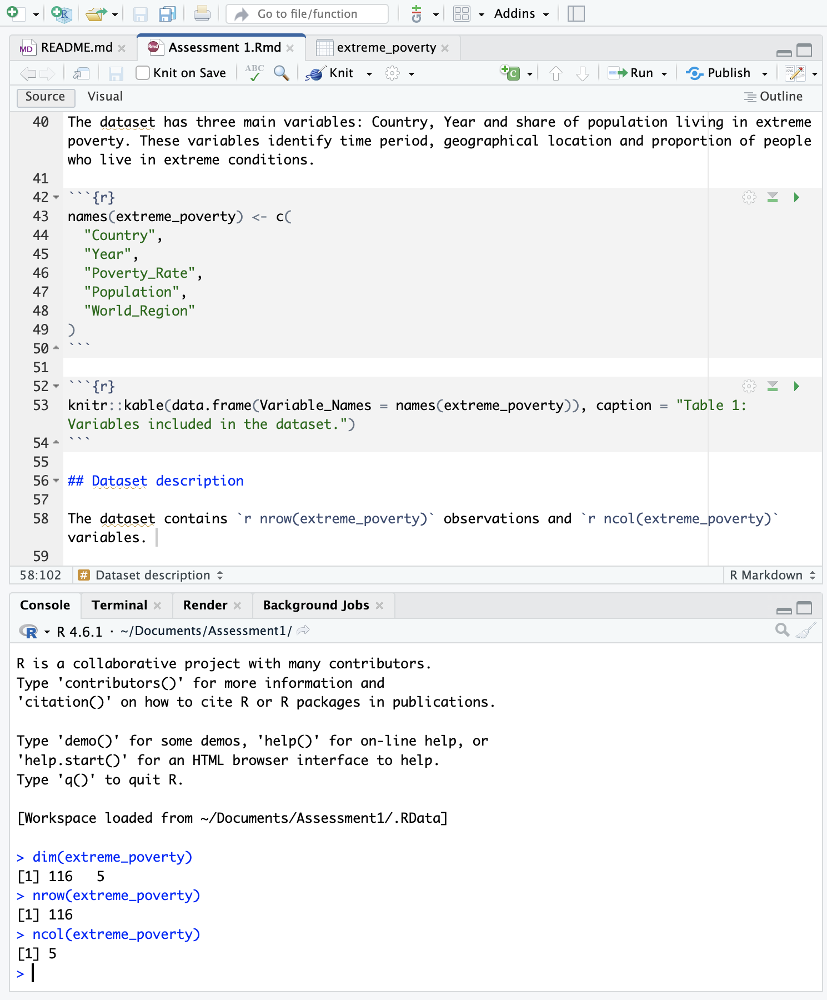

```{r setup, include=FALSE}
knitr::opts_chunk$set(fig.align = "center")

library(ggplot2)
library(dplyr)
library(readr)
library(knitr)
```


## Research Question: 
In this report we will investigate the proportion of population living in extreme poverty and, how this varies across countries. We aim to identify trends, patterns and differences in global economic inequality.

## Introduction: 
Our data looks at the proportion of the population living in extreme poverty over time across different countries. The data provides information in which we can investigate global inequality trends and differences, the data has been sourced from Our World in Data (Our World in Data, n.d.).

```{r}
extreme_poverty <- read.csv("Data/share-of-population-in-extreme-poverty.csv")
```

```{r}
extreme_poverty <- extreme_poverty %>%
   select(
    Entity,
    Year,
     Share.of.population.in.poverty...3.a.day.,
    Population,
     World.region.according.to.OWID
  )
```

## Dataset variables:
The dataset has three main variables: Country, Year and share of population living in extreme poverty. These variables identify time period, geographical location and proportion of people who live in extreme conditions.

```{r}
names(extreme_poverty) <- c(
  "Country",
  "Year",
  "Poverty_Rate",
  "Population",
  "World_Region"
)
```

```{r}
knitr::kable(data.frame(Variable_Names = names(extreme_poverty)), caption = "Table 1: Variables included in the dataset.")
```

## Dataset description

The dataset contains `r nrow(extreme_poverty)` observations and `r ncol(extreme_poverty)` variables. 

```{r, fig.align="left", fig.cap="Figure 1: Number of observations and variables in the dataset."}

```

The following output displays the first two observations and data types of each variable.

```{r}
str(head(extreme_poverty, 2))
```


